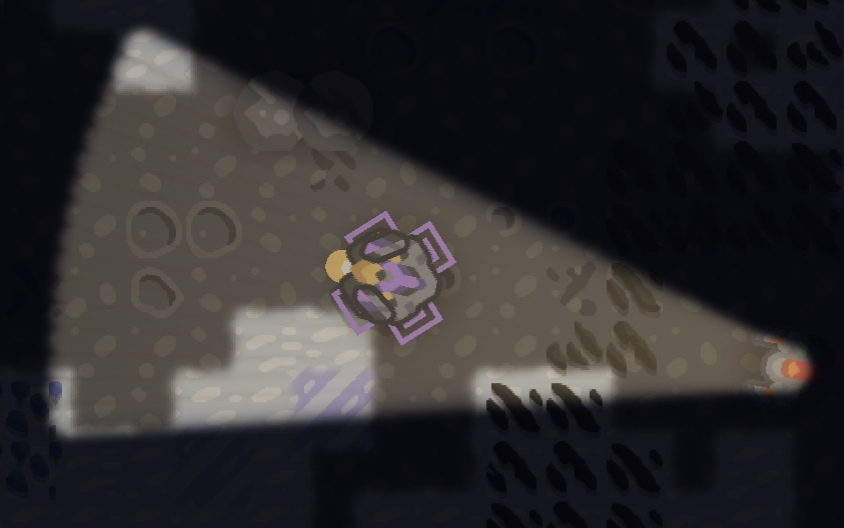

# mindustry-lighting

Adds various types of lighting sources to the player in Mindustry.
The source code is available as a single, self-contained Javascript file,
but I will not plan to add any new significant features to this project.

It's a purely client-side mod meaning that it won't affect the server and it's just for visuals.
If you want to experience this mod, you can turn on the lighting option in the custom map rules.

# Features
This mod currently adds two lighting methods: a flashlight and a lantern.
The flashlight acts as a spotlight for the player's unit,
and it casts many rays. You can see the ray intersections if you're a ground unit.

The lantern closely resembles the player's default lights.

## Flashlight
- The default light source of the mod.
- Instead of making light all around, it makes light only in the direction of the player.
- Rays can be obstructed by solid walls, if the player isn't flying or boosting.
- Can show enemies.
- Has settings, although they're limited (Made by @SMOLKEYS).

## Lantern
- Arguably known as the method of lighting the vanilla units used, but it's still similar to this.
- Makes light in every direction.
- Light cannot be obstructed.
- Also shows the enemies.
- Radius' still limited.
